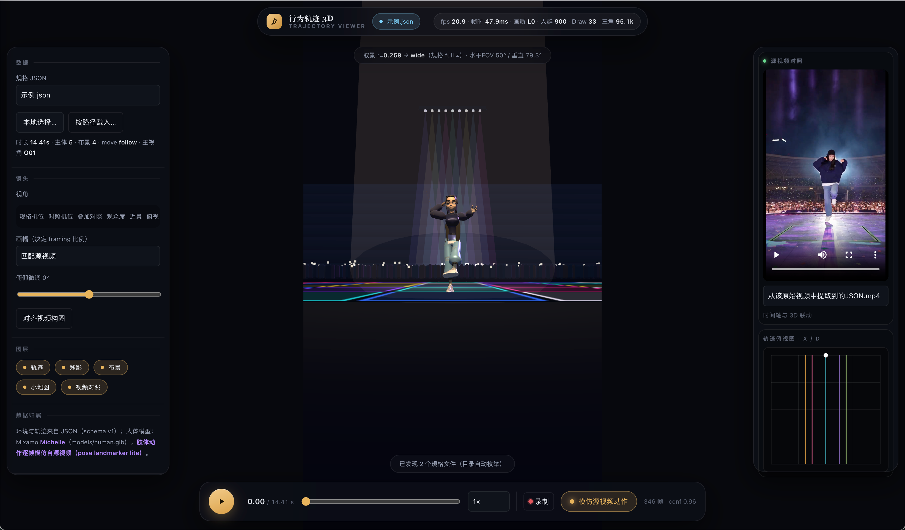
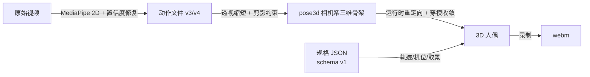

<div align="center">

# 🎬 行为轨迹 3D 查看器

**把一段原始视频，变成与视频等长、可播放、可导出的 3D 行为轨迹。**

轨迹（谁在哪、走哪条线、朝哪）由规格 JSON 决定 · 姿态（怎么动）由源视频决定

<p>
  
  
  
  
  
  
</p>



</div>

---

## 它解决什么

单目视频只有 2D。要还原一段舞蹈的 3D 行为，难点不在「渲染」，在**「缺的那一维」**：

| 难点 | 解法 | 实测结论 |
| :-- | :-- | :-- |
| **2D → 3D 缺深度** | 透视缩短反解 `\|Δz\| = √(L² − d²)`（L = 解剖骨长，d = 该骨画面投影长度），符号由解剖先验 + 帧间连续性 + **2D 剪影可见性约束**用 2 态 Viterbi 裁决 | 剪影约束触发 812 次，解剖先验满足率 **100%**，肘/腕深度符号翻转归零 |
| **多模态模型有边界** | 它只当**语义标注器**，不当几何测量器：深度序（实测可靠率 20~42%）与掌向（重复提问翻转率 35%）实测不可靠 ⇒ **不进渲染管线** | 语义通道（场景/动作/朝向）实测可靠：朝向 91~100%、抬臂 80~90% |
| **视频信息杂乱** | 一切歧义在离线消解成显式语义通道写回动作文件（转身/侧倾/重心/接触/置信度 + 相机系三维骨架），查看器退化为纯重定向 + 物理层 | 动作文件 v3/v4 单一契约；**换视频只改动作文件** |
| **准确性难校验** | 四层校验：渲染结果断言 + 深度离线断言 + **判据自检** + 多模态交叉校验 | 48/48 断言通过；穿模判据自检（已知体内点必判内、四个已知体外点必判外） |

---

## ✨ 能力速览

| | 能力 |
| :-- | :-- |
| 🧍 | **动作重定向** —— 源视频姿态驱动 Mixamo 骨架，手/脚落在视频里手/脚的位置（手部偏差 4.1%、脚部 3.8% 画面宽） |
| 🎥 | **对照机位** —— 按动作文件记录的源视频取景反解相机，3D 人偶与视频表演者同尺寸同位置（主体占比偏差 0.2%） |
| 🪞 | **叠加对照** —— 源视频作背景、3D 人偶直接叠上去，逐帧核对姿态最直接的方式 |
| 🎞️ | **录制导出** —— 当前画面录成 webm（叠加对照下即「视频 + 3D」对比片） |
| 🧠 | **深度重构** —— 单目反解出相机系三维骨架（米，髋中点原点），带逐骨可信度；不可信骨保持上次可信深度，两路径收敛不跳变 |
| 🛡️ | **穿模兜底** —— 穿模量用**躯干网格真值**（视线穿透区间）判定，不依赖三角形法向也不依赖奇偶；收敛沿相机射线推进，画面位置零变化 |
| ⌨️ | **操作** —— 空格播放/暂停 · ←→ 单帧步进 · Home/End 首尾 · 1-6 切镜头 · M 模仿开关 · R 录制 · 深链分享当前画面 |

---

## ⚡ 快速开始

### 1 · 装环境

```bash
python3 -m venv tools/.venv && tools/.venv/bin/pip install -r tools/requirements.txt
```

### 2 · 从视频产出动作文件

```bash
tools/.venv/bin/python tools/extract_motion.py 从该原始视频中提取到的JSON.mp4 --spec 示例.json --backend mp
```

> MediaPipe 权重首次运行自动下载到 `tools/models/`；检测器可换档位（`--pose-model lite|full|heavy`）。

### 3 · 起服务看轨迹

```bash
python3 serve.py --port 8000     # → http://127.0.0.1:8000/
```

动作文件与规格同名即自动配对，**姿态自动加载**（图层面板可开关「模仿源视频动作」）。

---

## 📊 实测数字

全部来自 `node tools/verify.mjs`（单浏览器实例，48 条断言）与 `tools/verify_depth.py`（纯计算），**阈值来自实测分布，未因结果调参**。

| 指标 | 实测 | 判据 |
| :-- | --: | :-- |
| 手部与源视频逐点对齐（E14） | **4.1%** 画面宽 | ≤ 8% |
| 脚部与源视频逐点对齐（E16） | **3.8%** 画面宽 | ≤ 8% |
| 对照机位：髋中点投影偏差（E13） | **0.5%** | < 3% |
| 穿模：手指网格真值最深（E18） | **0.7 mm** | ≤ 20 mm |
| 弯折侧向解剖违例（E7） | **0** | 弯折 15 mm / 伸直 30 mm |
| 膝角与动作文件三维骨架平均偏差（E3） | **12.6°** | ≤ 22° |
| 深度：关节深度逐帧差 95 分位（A2） | **37.7 mm** | ≤ 60 mm |
| 深度：三维-二维夹角中位差（A5） | **1.0°** | ≤ 15° |
| 多模态交叉校验一致率 | **0.71**（9 时刻 / 31 可比对） | 相对量，抽样带 ±0.07 |
| 运行时占用（截图时刻） | fps 20.9 · 帧时 47.9 ms · Draw 33 · 三角 95.1k · 人群 900 | 预算 Draw ≤40 / 三角 ≤120k / 人群 ≤900；帧时超预算自动降级 |

> **交叉校验怎么读**：同一个多模态模型分别看源视频帧与 3D 渲染帧、回答同一组题，一致率 = 轨迹与视频的一致性。它是**独立证据链**（不依赖本项目的解析式），但是相对量不是绝对准确率。剩余不一致两类来源：**粗三分类题**（肘弯 both/one/none）噪声大；**2D 检测自身的错**（t=2.5 右腕被头发遮住、检测贴到肩上，渲染忠实复现了错值）。详见 [vlm_boundary.md](docs/constraint/vlm_boundary.md)。

---

## 🧱 架构



| 层 | 位置 | 职责 |
| :-- | :-- | :-- |
| 几何内核 | `src/core/` | 射线求交 / 视线穿透区间 / 2 骨 IK 几何 / 弯折面搬运 / 可见手部穿透量 —— **零依赖**（无 DOM、无 three.js、无全局状态），可在 Node 里单测 |
| 应用层 | `src/app/` | 状态（`state`）· 布景（`scene`）· 人偶（`figure`）· 求解与收敛（`solver`）· 相机与 UI（`shell`） |
| 交付 | `index.html` | 由 `tools/build_page.py` 内联生成的**单文件产物**（运行零构建、`file://` 可直开） |
| 提取管线 | `tools/` | 置信度修复 → 逐帧归一化 → 去噪 → 语义通道 → 深度重构（`depth_reconstruct.py`）+ 左右归属翻转修复（`pose_repair.py`） |

---

## 📖 数据契约

<details>
<summary><b>规格 <code>*.json</code>（schema v1）</b> —— 轨迹与机位</summary>

| 字段 | 语义 |
| :-- | :-- |
| `shot.start / end` | 镜头时间范围（秒） |
| `camera.height_m / angle / pitch_deg / fov_deg / move / framing / subject` | 相机：`fov_deg` 是**水平** FOV（three.js 需 `2·atan(tan(hfov/2)/aspect)` 换算垂直）；`framing` = 可见高度/画面高（wide<0.35 / full 0.35–0.8 / medium 0.8–1.6 / close≥1.6）；`move=follow` 时相机跟随 `subject` |
| `subjects[]` | `id / class / desc / size_m / posture / path`；`path` 每项 `{t, pos_m:[x,d], facing_deg}` |
| `facing_deg` | 从 +x 逆时针：90 = 背对相机，270 = 面向相机 |
| `events[]` | `{t, what}`，时间点事件 |
| `environment` / `set[]` | 环境类型 / 布景项（地砖·人群·看台·灯排，`size_m` 为 `[宽, 深, 高]`） |

> **x 轴符号**：相机首帧朝 +Z，此时屏幕右 = 世界 −X，所以规格的 x 入料时取负，否则画面水平镜像（对称规格看不出来）。

</details>

<details>
<summary><b>动作 <code>*.motion.json</code>（v3/v4）</b> —— 姿态与语义</summary>

```jsonc
{
  "version": 4,
  "fps": 24, "frames": 346,
  "keys": ["nose", "...", "left_ankle", "right_ankle"],   // 17 点
  "poses":  [[[x, y, score], ...17], ...],               // 修复+去噪后的干净姿态（单位=该帧躯干长）
  "chan": {
    "yaw":     [...],   // 躯干转身角（弧度）：肩宽透视收缩=幅度，鼻−耳=方向
    "roll":    [...],   // 躯干侧倾（弧度）：躯干轴倾角，已扣相机滚转
    "root":    [[sx, sy], ...],  // 重心相对双脚中心的横移 / 髋高
    "contact": [[l, r], ...],    // 接触门控（脚踩实）
    "conf":    [...],            // 逐帧置信度
    "semantic": { "scene": "...", "facing": "front", "action": [...] }  // 多模态语义标注
  },
  "videoBox": { "w":360, "h":640, "K": 3.62, "frac": [...], "torsoPx": [...] },
  "pose3d":   [[[x, y, z], ...17], ...],   // 相机系三维骨架（米，髋中点原点）
  "pose3dConf": [...],                      // 逐骨可信度
  "body": { ... }                            // 骨段长度中位值等统计
}
```

坐标系：**相机系**（x = 画面右，y = 画面上，z = 远离相机），原点取髋中点，单位米。

**v1（旧格式）**：`version:1`，`poses` 为原始检测，查看器仍兼容（加载时自行去噪并推导通道）。

</details>

<details>
<summary><b>深度是怎么反解出来的</b></summary>

单目下每根骨的深度差由**透视缩短**唯一确定：`|Δz| = √(L² − d²)` —— 骨在画面上越短，它越是朝向镜头。

符号（骨在视线前方还是后方）由解剖先验（肘偏后 / 膝偏前 / 面朝前）+ 帧间连续性 + **2D 剪影可见性约束**裁决：肢体末端画在躯干剪影**内** ⇒ 它在躯干前方（被躯干挡住就看不见了）。这是 2D 唯一能直接给出的深度序线索。

横向骨（肩/髋/耳）的深度直接由偏航角给出 `±L·sin ψ`，比从 2D 肩宽反推干净得多（转身期肩宽骤变会把深度算飞）。

**离线只做去离群、不做低通**：任何低通都带滞后（One-Euro 0.8Hz 实测滞后 125ms），一帧的快速动作会被抹掉半个身位 —— 滞后比噪声更伤一致性。平滑交给运行时逐目标、按运动自适应地做。

</details>

---

## 🧪 四层校验

| 层 | 命令 | 判据 |
| :-- | :-- | :-- |
| **渲染结果断言** | `node tools/verify.mjs` | 48 条：量渲染结果（IK 命中、逐点对齐、穿模、弯折解剖、转身、接触门控、资源预算、构建产物同步） |
| **纯计算断言** | `tools/.venv/bin/python tools/verify_depth.py` | A1~A5：深度幅度不越界 / 逐帧连续性 / 符号稳定 / 解剖先验满足率 / 三维-二维夹角一致 |
| **判据自检** | 内含于 E19 | 度量本身要被已知点检验：已知体内点必须量出正深度、已知体外点必须量出 ≤0 —— 否则「恒为 0」会被读成「没有穿模」 |
| **多模态交叉校验** | `tools/.venv/bin/python tools/verify_vlm.py --tag=<t>` | 独立证据链：同一模型看视频帧与渲染帧、回答同题 |

还有一层**内核单测**（秒级、不开浏览器）：`node tools/test_core.mjs` —— 9 条几何不变量（射线求交、视线区间符号连续、2 骨 IK 骨长守恒、弯折面刚体搬运……）。

浏览器纪律：单实例、每轮至多一次有界验收、结束必 kill 并自查残留进程。

---

## 🚧 已知不可观测

单目正面的物理限制，不是实现缺陷。写清楚比反复尝试修更省时间：

- 肢体深度**符号**在剪影证据缺失处（手在身前还是在身后，正视图只给剪影）
- 绕竖轴的**真实扭转**（正视图下肩线投影方位不随 yaw 变）
- **腾空高度**、**手指逐节姿态**
- **被头发/衣物遮挡的关节**（t=2.5 右腕被头发盖住，检测贴到肩位）

轨迹由规格决定、姿态由视频决定，正是这个分工的原因。

---

## 🗺️ 状态与路线

**当前状态**：核心链路完整可用（48/48 断言通过）；作为通用查看器可用，作为**生产级动作捕捉**仍有上面那几项物理限制。

- [x] 轨迹/机位 schema v1、动作文件 v3/v4、深度重构与剪影约束
- [x] 穿模网格真值判据 + 运行时收敛 + 判据自检
- [x] 渲染层模块化（纯几何内核可秒级单测）+ 单文件产物交付
- [ ] 视频级 3D 姿态估计接入（替代逐帧检测，消除深度符号歧义）
- [ ] 开源许可声明（第三方资产许可见 [models/CREDITS.md](models/CREDITS.md)）

---

## 🤝 参与

先读 [AGENTS.md](AGENTS.md)（铁律与执行顺序）与 [docs/constraint/quality.md](docs/constraint/quality.md)（门控）。改渲染层后必跑：

```bash
tools/.venv/bin/python tools/build_page.py   # 重建单文件产物
node tools/test_core.mjs                    # 内核单测（秒级）
node tools/verify.mjs                       # 有界验收（48 断言）
```

每实装一个任务写 `docs/tasklist/TASKNNNN_*.md`，每发现一个缺陷写 `docs/buglist/BUGNNNN_*.md`（编号单调递增，含根因与回归结论）。

## 📄 许可

本仓库尚未声明开源许可（待定）。第三方资产与依赖的许可见 [models/CREDITS.md](models/CREDITS.md)（three.js MIT、Mixamo 角色免费商用、MediaPipe/MoveNet 权重许可）。
